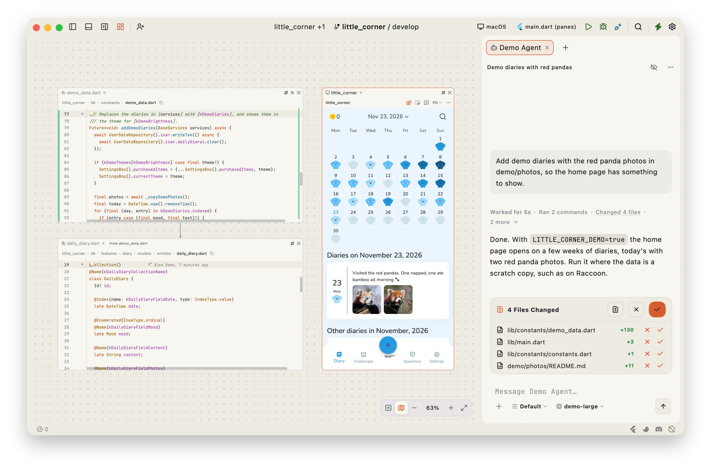
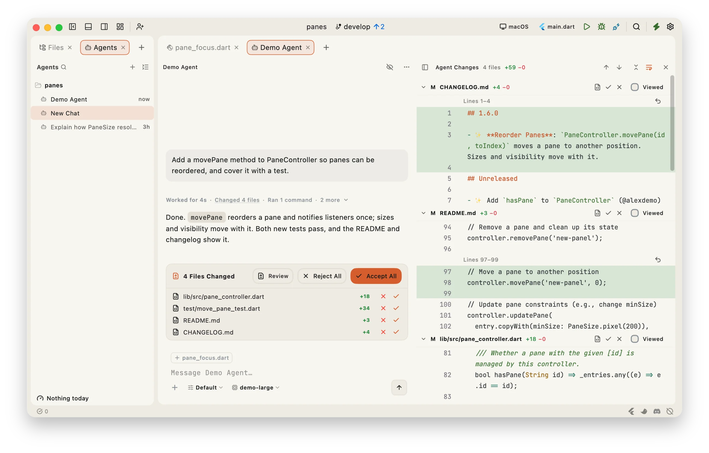
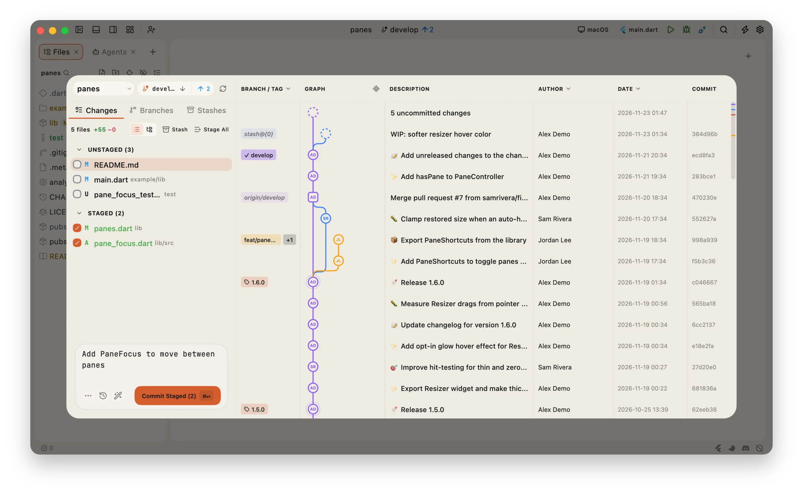
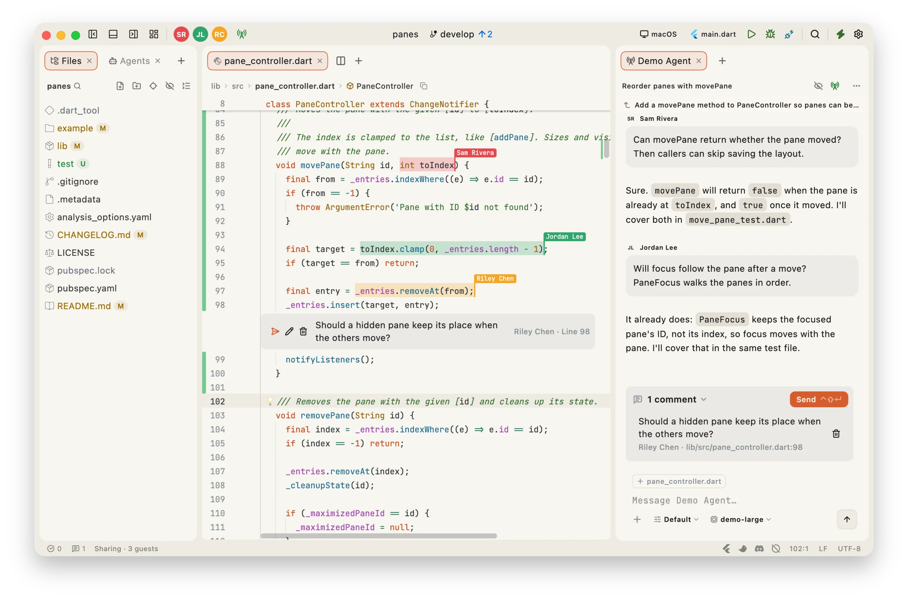

<p align="center">
  
</p>

<h1 align="center">Lumide</h1>

<p align="center">
  <b>Native speed for agent-native development.</b>
</p>

<p align="center">
  An IDE in pure Flutter and Dart, for macOS, Windows and Linux.
</p>

<p align="center">
  <a href="https://github.com/SoFluffyOS/lumide/releases/latest"></a>
  
  <a href="https://discord.gg/VP6p5JQdgt"></a>
</p>

<p align="center">
  <a href="https://lumide.dev">Website</a> · <a href="https://docs.lumide.dev">Docs</a> · <a href="https://blog.sofluffy.io">Blog</a> · <a href="https://dartpad.lumide.dev">Try it in your browser</a>
</p>

Hi folks 👋

Most editors today are a web browser in disguise. They take seconds to start, use a gigabyte doing nothing, and AI agents get bolted onto the side.

**Lumide** is a **native** desktop IDE. No Electron, no browser engine, no JavaScript. It starts in about **200 ms** and sits around **80 MB** idle.

- 🏎️ **Native code, drawn on the GPU.** Dart compiles ahead of time to ARM64 and x64 machine code, and Flutter draws every pixel itself on the GPU. There is no web page underneath.
- ⚡ **Fast by design.** A rope-based text engine and virtualized rendering keep typing instant, even in huge files.
- 🤖 **Agent-native.** Run Claude, GitHub Copilot, OpenCode or any agent that speaks the Agent Client Protocol, and review its changes before you keep them.
- 💙 **Made for Flutter and Dart**, and at home in 40+ other languages through LSP.

<p align="center">
  <picture>
    <source media="(prefers-color-scheme: dark)" srcset="assets/readme/hero-dark.webp">
    
  </picture>
</p>

## ✨ What you get

### 🤖 Agent Chat

- Run any [ACP](https://agentclientprotocol.com) agent: Claude, GitHub Copilot, OpenCode and the rest of the registry.
- Give the chat the middle of the window, not a narrow side panel. The files it edits open beside it.
- Review what it changed side by side, file by file.
- **Revert here** takes both the chat and your files back to any earlier point.
- Message an agent while it works. It reads you right away and keeps going.
- **Ghost text** completions as you type, multiline, one `Tab` to accept.

<p align="center">
  <picture>
    <source media="(prefers-color-scheme: dark)" srcset="assets/readme/agent-chat-dark.webp">
    
  </picture>
</p>

### ✏️ The editor

- Multi-cursor, column selection, folding, snippets, find and replace with regex.
- Go to Definition, usages, call hierarchy, the Structure pane, sticky scroll and inlay hints.
- Keymaps for **JetBrains**, **VS Code** and **Sublime Text**, plus [Vim mode](https://docs.lumide.dev/vim).
- Markdown, SVG and HTML previews right beside the code.
- **Hot Exit** and **Local History**: quit with unsaved work, or go back to any earlier version of a file.

### 🦉 O.W.L. board

- Lay your panes out on a canvas you pan and zoom, instead of tiles.
- Go to Definition opens the file beside the one you came from, linked by a curve. Follow an agent and the board keeps its trail.
- Flutter apps you run on **Raccoon** open in frames of their own, at their device's size.

See [O.W.L.](https://docs.lumide.dev/workspace/split-panes#owl) in the docs.

### 🐶 C.O.R.G.I. Git client

**C**lean **O**rganized **R**epository **G**it **I**nterface, built in.

- A commit graph with branch lanes, hunk staging, stashes and blame.
- Drop, reword, squash and fixup commits right from the graph, with Undo right after.
- The keys you know from lazygit.
- Gutter marks and inline blame in the editor, and merge conflicts solved in one pane.

<p align="center">
  <picture>
    <source media="(prefers-color-scheme: dark)" srcset="assets/readme/git-dark.webp">
    
  </picture>
</p>

### 👥 Share a workspace

- Send a link. Anyone opens it in Lumide or a browser, **no account needed**, and you let each person in.
- Pick what each guest can do: **Viewer**, **Editor** or **Trusted**. Only Trusted guests run terminals, tasks and Git on your machine.
- Share a terminal or an Agent Chat, and see everyone's carets live.

See [Sharing a Workspace](https://docs.lumide.dev/workspace/collaboration).

<p align="center">
  <picture>
    <source media="(prefers-color-scheme: dark)" srcset="assets/readme/collaboration-dark.webp">
    
  </picture>
</p>

### 🌍 Remote and multi-root

- **Remote SSH**: open a folder on another machine. Files, terminals, Git and language servers run there. Lumide stays on yours. [Docs](https://docs.lumide.dev/workspace/remote-ssh).
- **Several folders in one window**, each with its own Git. Save them to a `.lumide-workspace` file, commit it, and your team opens the same set. [Docs](https://docs.lumide.dev/workspace/multi-root).

### 💙 Flutter and Dart

- Run, hot reload and debug with breakpoints.
- The **SDK Manager** finds your Flutter and Dart SDKs, FVM included.
- [DartPad](https://dartpad.lumide.dev): Lumide in your browser, editing and running Dart and Flutter with no server.

### 🔌 Plugins and themes

- Plugins are Dart packages on **pub.dev**, built with the MIT-licensed [`lumide_api`](https://pub.dev/packages/lumide_api).
- Python, Go, Rust, TypeScript, Swift and more, one click away in the Marketplace.
- Built-in themes, or install community ones.

Every feature has its own page in the [docs](https://docs.lumide.dev).

## 🏎️ "Isn't Flutter non-native?"

Nope. Flutter often gets lumped in with hybrid apps that run in a WebView. Here's what actually runs:

- **Machine code.** The release build compiles Dart ahead of time to native ARM64 or x64, the same way C++ or Swift does. No interpreter, no JIT, no JavaScript.
- **Its own renderer.** Flutter doesn't wrap HTML or the system's widgets. It draws every frame itself on the GPU (Metal on macOS). That's how the editor and the terminal stay smooth.
- **A real app.** A signed `.app` on macOS, an `.exe` on Windows, an ELF binary on Linux. It talks to the OS directly for files, processes, menus and windows.
- **Built the way Zed is.** Compiled to machine code and drawn by its own renderer on the GPU, with no browser underneath. Zed does it in Rust. Lumide does it in Dart and Flutter, with its own engine.

Electron apps ship a whole Chromium browser and render the UI as a web page. Lumide doesn't: a WebView only shows up when a plugin opens a web panel of its own. That's where the 200 ms start and the 80 MB come from.

## 💻 Platforms

| Platform | Download | Good to know |
|---|---|---|
| 🍏 **macOS** | `.dmg` for Apple Silicon, Intel, or both | macOS 12 or later. Signed and notarized by Apple. |
| 🪟 **Windows** | `.zip` (x64) | Extract it and run `Lumide.exe`. No installer needed. |
| 🐧 **Linux** | One-line install, or `.tar.gz` (x64, ARM64) | Adds `lumide` to your path and Lumide to your app launcher. |

## 📦 Install

Grab the build for your machine from **[lumide.dev](https://lumide.dev)** or the [releases page](https://github.com/SoFluffyOS/lumide/releases).

On Linux, one line does it:

```bash
curl -fsSL https://lumide.dev/install.sh | sh
```

From then on, Lumide tells you when a new version is out and installs it in one click. That's it. 🚀

New here? The [installation guide](https://docs.lumide.dev/getting-started/installation) and [first-run setup](https://docs.lumide.dev/getting-started/first-run) walk you through it.

## 🔒 Privacy

Lumide collects **no usage data**. Your code stays on your machine.

AI agents and plugins you add talk to their own services, under their own terms. You pick which ones.

## 🤝 Feedback

This repository holds Lumide's releases and its issue tracker. The source isn't published, but your reports shape every release.

- 🐛 **A bug?** [Open an issue](https://github.com/SoFluffyOS/lumide/issues/new). Copy the logs from the **Log Viewer** (in the Command Palette) into it: they help me fix things much faster.
- 💡 **An idea?** Open a feature request, or talk it through on [Discord](https://discord.gg/VP6p5JQdgt).
- 🔐 **A security problem?** Please report it privately. See [SECURITY.md](SECURITY.md).

More in [CONTRIBUTING.md](CONTRIBUTING.md). What's new in each version is in [CHANGELOG.md](CHANGELOG.md).

## Happy Coding 🦊
